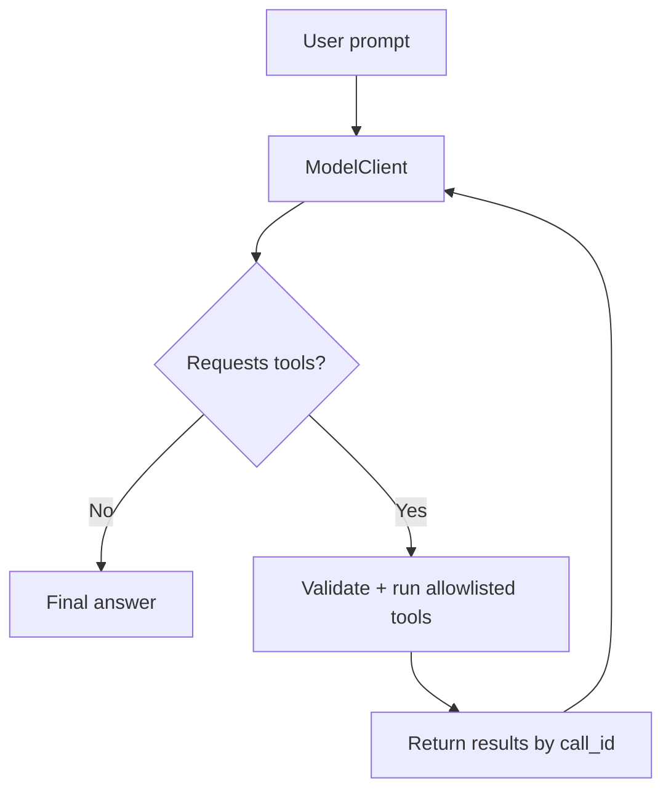

# TypeScript Tool-Calling Agent

A small, testable reference implementation of the **tool-calling loop** used in AI agents.

An agent can request a function; **application code** validates its arguments, executes an allowlisted function, and returns a structured result. This repository focuses on that orchestration layer rather than a web interface.

**Stack:** TypeScript, Node.js 22.16+, native `fetch`, native test runner. No runtime dependencies.

> **Important:** `npm start` runs a **scripted offline demo**, not an actual language model. It requires no account, key, or payment. The optional `npm run live` command uses the OpenAI Responses API and requires separately billed API access. All service data is synthetic.

## Features

- Three read-only tools: `get_service_status`, `search_incidents`, `calculate_error_rate`.
- Strict tool schemas and runtime argument validation.
- Multiple function calls per round, correlated using `call_id`.
- Bounded tool-calling loop with safe error responses and trace logs.
- A replaceable `ModelClient` interface: scripted mock for local testing; real API transport available if desired.
- Automated tests that never call external APIs.

## Run locally

Use **Node.js 22.16 or newer**. Open this folder in VS Code and run the following in the terminal.

**Windows PowerShell:**

```powershell
npm.cmd install
npm.cmd start
npm.cmd test
npm.cmd run typecheck
```

The `.cmd` suffix avoids common PowerShell script execution restrictions. Make sure your terminal is in this project's directory, **not** `C:\Windows\System32`.

**macOS / Linux:**

```bash
npm install
npm start
npm test
npm run typecheck
```

Expected demo outcome:

```text
Mode: offline demo (no LLM)
[tool] get_service_status | ok
[tool] search_incidents | ok
[tool] calculate_error_rate | ok

Answer:
DEMO (scripted calls, no LLM): payments-api is degraded in a synthetic dataset.
36 failures out of 1,200 requests (3% error rate).
Matching incident IDs: INC-104, INC-099.
```

The mock deliberately requests tools in a fixed order. It **does not understand arbitrary prompts**; this is a reproducible example of the orchestration, not an AI capability benchmark.

## How it works



The scripted demo follows this sequence:

1. The mock requests service status and incident history.
2. Application code validates and executes both tools.
3. The mock reads the returned request counts and requests an error-rate calculation.
4. The app calculates `36 / 1200 * 100 = 3` and returns the result.
5. The mock formats a final summary from actual tool outputs.

**The calculation is performed by ordinary application code, not by an LLM.**

## Repository layout

```text
src/
  cli.ts       # Command-line entry point
  agent.ts     # Tool-calling orchestration and safety limits
  clients.ts   # Deterministic mock and optional API client
  tools.ts     # Tool definitions, allowlist, validators, implementations
  data.ts      # Synthetic service and incident data
  types.ts     # Shared TypeScript contracts
tests/
  agent.test.ts
  tools.test.ts
  review.test.ts
docs/
  architecture.md
```

## Optional: run against a real model

**Not necessary to run, test, or review this repository.** This mode can incur separate API charges.

1. Copy `.env.example` to `.env`.
2. Add `OPENAI_API_KEY` in `.env` locally; never commit it.
3. Use:

```powershell
npm.cmd run live -- "Check payments-api and calculate its error rate"
```

Live requests use an OpenAI-compatible Responses API client. This optional path has **not** been verified against a live account in this repository. API availability, model support, and billing depend on your account.

## Engineering choices and limits

- Tool results are untrusted input. Model-supplied tool names are matched to an explicit allowlist; there is no shell execution.
- The orchestrator limits response rounds and tool calls to prevent uncontrolled loops.
- Invalid arguments produce errors that the model can handle; secrets and raw provider error bodies are not printed.
- Tool results return in the request's `call_id` order even when read-only tools run concurrently.
- The fixture data is fake; this project does not access a bank, payment processor, or real production service.
- No actual AI inference happens offline. To evaluate an actual model, use a separate API or local model integration and add evaluation cases.

See [architecture notes](docs/architecture.md).

## License

MIT. See [LICENSE](LICENSE).
